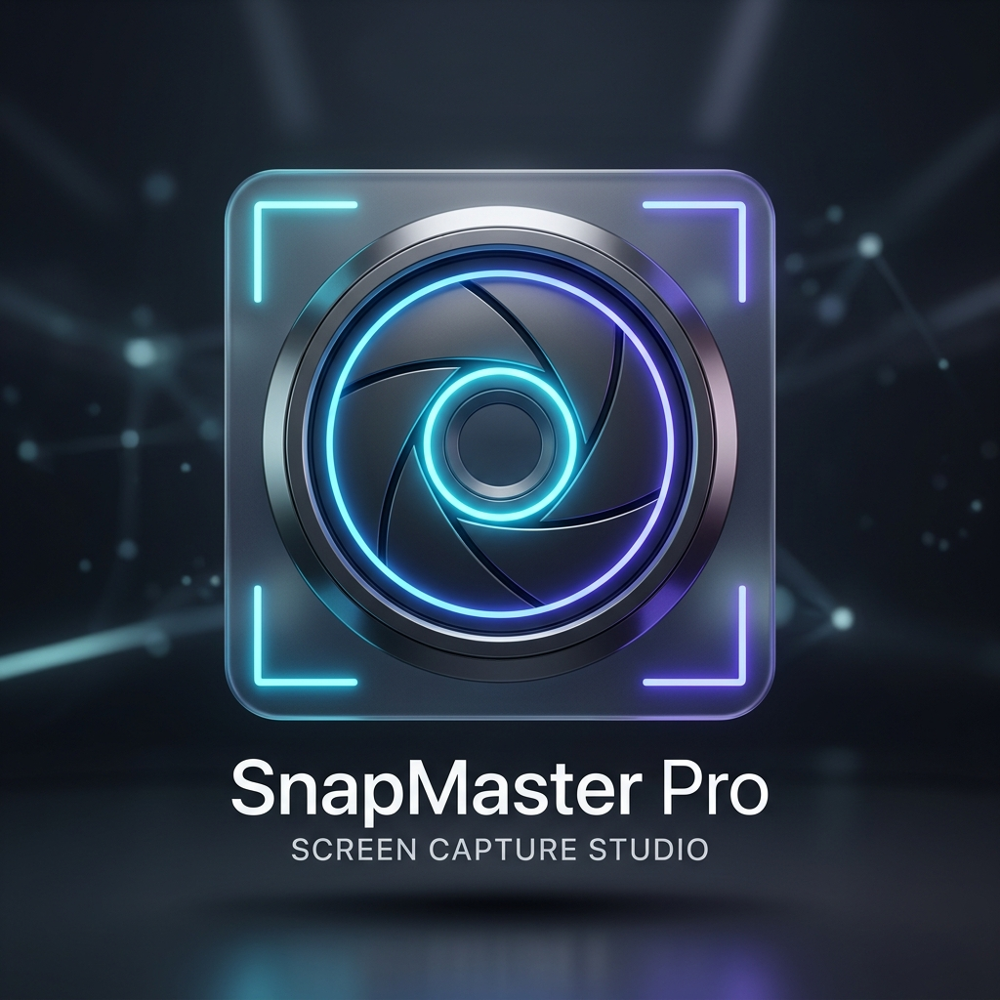

<div align="center">



# SnapMaster Pro 📸
### Ultimate Screen Capture Studio, Annotation Suite & Smart OCR for Windows PC

[](https://www.python.org/)
[](https://riverbankcomputing.com/software/pyqt/)
[](https://microsoft.com/windows)
[](https://github.com/test-bit-sys/SnapMaster-Pro)
[](LICENSE)

---

### 🏷️ Topics
`screenshot` • `screen-capture` • `ocr` • `winocr` • `tesseract` • `pyqt6` • `snipaste` • `sharex` • `snagit` • `annotation-tool` • `windows` • `desktop-app` • `image-editor` • `productivity`

</div>

---

## 🌟 Overview

**SnapMaster Pro** is a modern, high-performance, open-source screen capture and annotation studio designed specifically for Windows 10 and 11. Built from the ground up with **PyQt6**, it blends the speed and ease of lightweight snip tools with the rich annotation powers of **Snagit**, the pinning innovation of **Snipaste**, and the offline power of **Native Windows Media OCR**.

Whether you are creating documentation, reporting bugs, capturing meeting slides, or extracting text from uncopyable screen areas, SnapMaster Pro delivers a seamless, pixel-perfect experience with zero resource bloat.

---

## 🚀 Key Features

### 1. 🎯 Precision Capture Modes
- **✂️ Region Snip:** Smooth, pixel-accurate selection with resize handles, keyboard nudging, and live coordinate feedback.
- **🖥️ Fullscreen Capture:** Instant single-click capture across all connected monitors (Multi-Monitor Virtual Desktop support).
- **🪟 Active Window Capture:** Clean window snapping using the Windows Desktop Window Manager (DWM) API without drop-shadow clipping artifacts.
- **⏱️ Timed Delay Capture:** 3s, 5s, or 10s countdown timers to capture dropdown menus, tooltips, and interactive UI states.

### 2. 🔍 Live Pixel Magnifier & Color Picker
- Instant **5x–8x zoom loupe** around your mouse cursor during capture.
- Pixel grid with a single-pixel targeting crosshair.
- Real-time **RGB** and **HEX Color** inspection (perfect for UI/UX designers and front-end developers).
- Live cursor coordinates `(X, Y)` and selection dimensions `(W × H)`.

### 3. ⚡ Smart Dual-Engine OCR (Optical Character Recognition)
- **⚡ Native Windows Media OCR:** Uses the built-in Windows 10/11 OCR runtime via `winocr`. **Zero external installation required**, lightning-fast, and works completely offline.
- **🔍 Tesseract OCR Support:** Automatic path discovery for standalone Tesseract installations as a secondary engine.
- **⚡ One-Click OCR from Snipping Toolbar:** Extract text directly from the snip overlay without even opening the full editor (`Ctrl + T`).
- **📋 Smart OCR Inspector:**
  - One-click **Copy to Clipboard**.
  - **Clean Formatting** to remove unwanted line breaks and redundant spaces.
  - **Direct Google Search** with one click.
  - **Save as TXT File**.
  - Real-time word and character counters.

### 4. 🎨 Annotation Studio
- **↘️ Directional Arrows:** Sharp triangular-headed callout arrows.
- **🔲 Geometric Shapes:** Crisp rectangles, rounded rectangles, and ellipses with outline or solid fill modes.
- **✏️ Freehand Pen:** Smooth drawing with antialiased curves.
- **🖍️ Highlighter:** Semi-transparent fluorescent highlighter to emphasize code and text.
- **💧 Mosaic & Blur:** High-density pixelation filter to redact passwords, phone numbers, and sensitive information.
- **🔤 Badged Text:** High-contrast text overlays with rounded dark backdrops for readability on any background.
- **🔢 Step Counter Badges:** Automatic incrementing circular numbers `(1, 2, 3...)` for tutorials and bug reproduction guides.
- **⭐ Quick Stamps:** Quick feedback markers (`✓`, `✗`, `⭐`, `❓`, `⚠️`, `❤️`, `➜`).
- **✂️ In-Canvas Crop:** Re-crop and trim images directly inside the editor.
- **📄 Multi-Format Export:** Save as **PNG**, **JPEG**, **WebP**, or export directly into a **PDF Document**!
- **↩️ Unlimited Undo / Redo:** Full history stack for safe and reversible modifications.

### 5. 📌 Pin to Screen (Always on Top)
- Inspired by Snipaste: float your captured screenshots anywhere on your desktop above all running applications.
- Drag and move effortlessly.
- **Opacity Control:** Scroll your mouse wheel over the pinned window to adjust transparency (100% down to 20%)—ideal for referencing blueprints, code, or design comps.
- **Scale Control:** `Ctrl + Mouse Wheel` to dynamically scale up or down.
- **Direct OCR:** Right-click any pinned screenshot and extract text instantly.

### 6. 🔔 Modern Toast Notifications (HUD)
- Non-intrusive floating glassmorphic toast notification at the bottom-right corner of your screen.
- Instant actions: click to open the screenshot folder or jump directly into the editor.

### 7. 🖼️ Screenshot History Gallery & Live Search
- Visual thumbnail gallery of all past screenshots with file size, dimensions, and timestamps.
- **Instant Search Bar:** Filter captures by date or name in real-time.
- **Direct Actions:** Open in Editor, Copy, Show in File Explorer, Delete, or run OCR on past captures.

### 8. 🛡️ Silent Background Execution & Windows Autostart
- **Seamless System Tray Integration:** Closing the dashboard window minimizes to the Windows System Tray while keeping global hotkeys active.
- **Persistent Background Hotkeys:** Trigger screen capture and OCR anytime without keeping open windows on your desktop.
- **Silent Startup Mode:** Run with `--minimized` or `--background` to start directly into the system tray with zero screen intrusion.
- **One-Click Windows Autostart:** Easily configure SnapMaster Pro to launch automatically in the background on Windows boot via Preferences.

---

## ⌨️ Default Keyboard Shortcuts

| Shortcut | Description |
| :--- | :--- |
| `Ctrl + Shift + S` | Capture Region (Global Hotkey) |
| `Ctrl + Shift + F` | Capture Fullscreen (Global Hotkey) |
| `Ctrl + Shift + W` | Capture Active Window (Global Hotkey) |
| `Space` / `F` | Select Entire Screen inside Snipping Overlay |
| `Ctrl + T` | Extract Text via OCR immediately |
| `Enter` / Double Click | Confirm selection & open in Annotation Studio |
| `Ctrl + C` | Copy screenshot directly to Clipboard |
| `Ctrl + S` | Save screenshot to file |
| `Ctrl + P` | Pin screenshot as floating desktop widget |
| `Ctrl + Z` | Undo last annotation |
| `Ctrl + Y` | Redo annotation |
| `Arrow Keys` | Nudge selection rectangle (Hold `Shift` for 10px steps) |
| `Esc` | Cancel capture or close floating widget |

---

## 🛠️ Installation & Getting Started

### 1. Prerequisites
- **Operating System:** Windows 10 (Build 1809+) or Windows 11 (64-bit recommended).
- **Python:** Python 3.10 or higher.

### 2. Clone the Repository
```bash
git clone https://github.com/test-bit-sys/SnapMaster-Pro.git
cd SnapMaster-Pro
```

### 3. Install Dependencies
```bash
pip install -r requirements.txt
```

### 4. Run the Application
```bash
python main.py
```

---

## 📦 Building Standalone Executable (.exe)

You can package SnapMaster Pro into a standalone Windows executable that runs without requiring Python to be installed:

```bash
python build_exe.py
```

The compiled binary will be located at:
`dist/SnapMasterPro/SnapMasterPro.exe`

---

## 📂 Project Architecture

```
SnapMaster-Pro/
├── main.py                     # Application entry point & service coordinator
├── core/
│   ├── capture.py              # DWM window bounds, multi-monitor virtual screen capture
│   ├── config.py               # User preferences & persistent JSON configuration
│   ├── hotkeys.py              # Global background keyboard shortcut listener
│   ├── history.py              # Screenshot logging, metadata & auto-save manager
│   ├── ocr_engine.py           # Smart Dual OCR engine (Native WinOCR + Tesseract)
│   └── sound.py                # Asynchronous camera shutter audio feedback
├── ui/
│   ├── styles.py               # Modern dark theme design system
│   ├── main_window.py          # Dashboard window & primary action cards
│   ├── overlay.py              # Snipping canvas, live magnifier & quick action toolbar
│   ├── editor_window.py        # Complete annotation studio & multi-format exporter
│   ├── pin_window.py           # Frameless floating pin widget with opacity controls
│   ├── toast.py                # Floating interactive Toast HUD notification
│   ├── history_dialog.py       # Visual history browser with real-time search
│   ├── settings_dialog.py      # Comprehensive settings and preferences dialog
│   └── tray.py                 # System tray icon, notifications & background menu
├── assets/
│   ├── banner.png              # 4K branding banner
│   ├── icon.ico                # Multi-resolution Windows application icon
│   ├── icon.png                # High-resolution PNG logo
│   └── shutter.wav             # Mechanical camera shutter sound effect
├── build_exe.py                # PyInstaller compilation script
├── requirements.txt            # Dependency specification
├── .gitignore                  # Git ignore rules
├── LICENSE                     # MIT License
└── README.md                   # Complete English documentation
```

---

## 📄 License

This project is licensed under the **MIT License** - see the [LICENSE](LICENSE) file for details.

---

<div align="center">
Developed with ❤️ by <a href="https://github.com/test-bit-sys">test-bit-sys</a>
</div>
